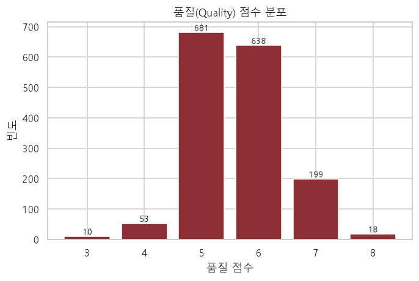
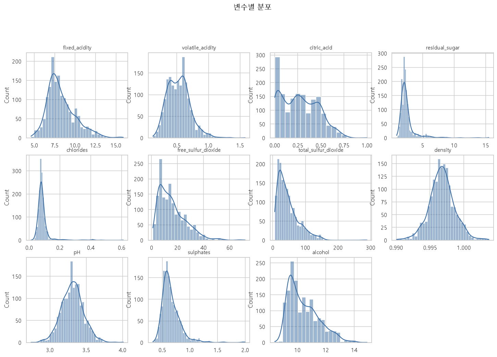
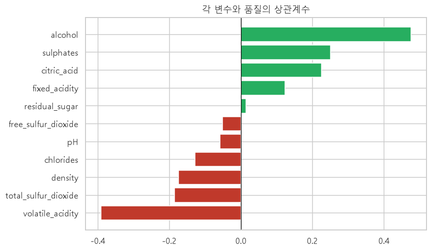
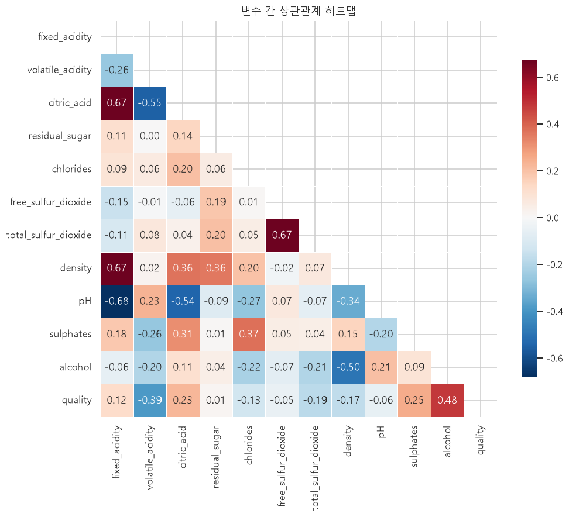
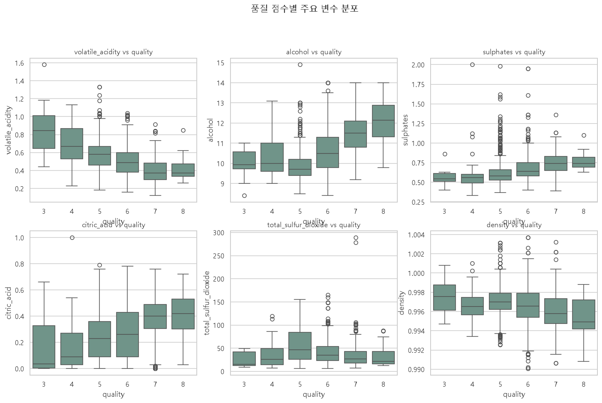
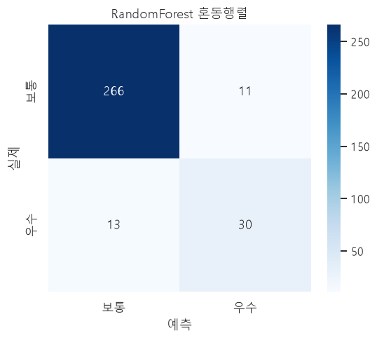
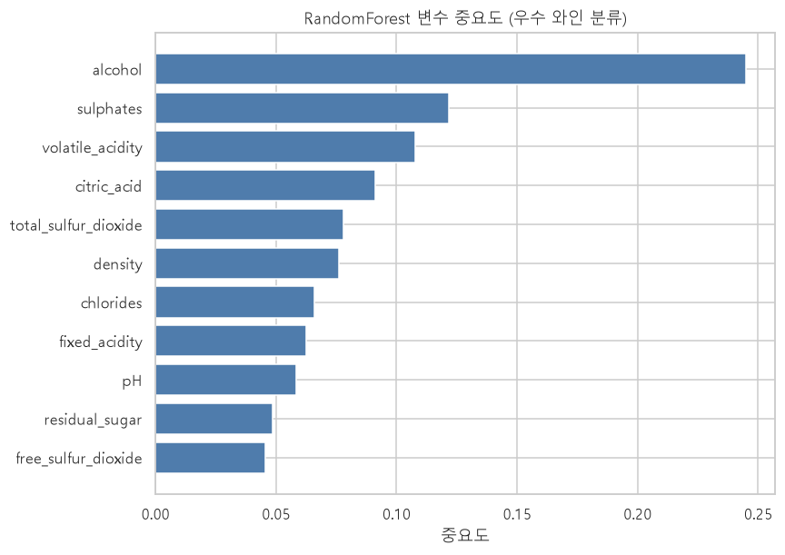

# 레드와인 품질 분석 보고서

**데이터셋**: UCI Machine Learning Repository — Wine Quality Data Set (Cortez et al., 2009)
**배포 경로**: Kaggle `uciml/red-wine-quality-cortez-et-al-2009`
**분석 환경**: Python 3.12 / pandas · scikit-learn · matplotlib · seaborn · Streamlit

---

## 1. 요약 (Executive Summary)

레드와인 1,599개의 물리·화학적 측정값(11개 변수)을 이용해 품질 점수(3~8)를 분석하였다.
품질은 **알코올 도수**와 가장 강한 양의 상관(+0.48)을, **휘발성 산도**와 가장 강한 음의 상관(−0.39)을 보였다.
"품질 ≥ 7 = 우수 와인"으로 정의한 이진 분류에서 **RandomForest가 정확도 0.925, ROC-AUC 0.943**을 기록하여
실무 수준의 우수 와인 선별이 가능함을 확인했다.

| 핵심 지표 | 값 |
|---|---|
| 표본 수 | 1,599개 (결측 0, 중복 240) |
| 평균 품질 | 5.64점 (3~8) |
| 우수 와인(≥7) 비율 | 13.6% (217개) |
| 품질과 최고 상관 변수 | 알코올 (+0.48) |
| 최고 모델 | RandomForest — Accuracy 0.925 / ROC-AUC 0.943 |
| 5-fold 교차검증 ROC-AUC | 0.866 ± 0.033 |

---

## 2. 데이터 이해

### 2.1 변수 구성

| 변수 | 의미 | 단위 |
|---|---|---|
| fixed_acidity | 고정 산도 | g/L |
| volatile_acidity | 휘발성 산도 (식초 맛) | g/L |
| citric_acid | 구연산 | g/L |
| residual_sugar | 잔당 | g/L |
| chlorides | 염화물 (소금) | g/L |
| free_sulfur_dioxide | 유리 이산화황 | mg/L |
| total_sulfur_dioxide | 총 이산화황 | mg/L |
| density | 밀도 | g/cm³ |
| pH | 산도 지수 | – |
| sulphates | 황산염 | g/L |
| alcohol | 알코올 도수 | % vol |
| **quality** | **품질 점수 (목표 변수)** | 0~10 |

### 2.2 품질 점수 분포

품질은 이산형이며 **5점(681개)·6점(638개)에 전체의 82%가 집중**되어 있다.
7점 이상은 13.6%에 불과하고 3·4점과 8점은 매우 적어 **클래스 불균형**이 뚜렷하다.

| 품질 | 3 | 4 | 5 | 6 | 7 | 8 |
|---|---|---|---|---|---|---|
| 빈도 | 10 | 53 | 681 | 638 | 199 | 18 |



### 2.3 기술 통계 (발췌)

| 변수 | 평균 | 표준편차 | 중위수 | 최소 | 최대 | 왜도 |
|---|---:|---:|---:|---:|---:|---:|
| fixed_acidity | 8.32 | 1.74 | 7.9 | 4.6 | 15.9 | 0.98 |
| volatile_acidity | 0.53 | 0.18 | 0.52 | 0.12 | 1.58 | 0.67 |
| citric_acid | 0.27 | 0.20 | 0.26 | 0.00 | 1.00 | 0.32 |
| residual_sugar | 2.54 | 1.41 | 2.20 | 0.9 | 15.5 | 4.54 |
| chlorides | 0.087 | 0.047 | 0.079 | 0.012 | 0.611 | 5.68 |
| free_sulfur_dioxide | 15.88 | 10.46 | 14.0 | 1.0 | 72.0 | 1.25 |
| total_sulfur_dioxide | 46.47 | 32.90 | 38.0 | 6.0 | 289.0 | 1.52 |
| density | 0.997 | 0.002 | 0.997 | 0.990 | 1.004 | 0.07 |
| pH | 3.31 | 0.15 | 3.31 | 2.74 | 4.01 | 0.19 |
| sulphates | 0.66 | 0.17 | 0.62 | 0.33 | 2.00 | 2.43 |
| alcohol | 10.42 | 1.07 | 10.2 | 8.4 | 14.9 | 0.86 |
| quality | 5.64 | 0.81 | 6.0 | 3.0 | 8.0 | 0.22 |

`residual_sugar`(왜도 4.5), `chlorides`(5.7), `sulphates`(2.4)는 오른쪽으로 긴 꼬리를 보여
이상치 존재 가능성이 높다.

---

## 3. 탐색적 데이터 분석 (EDA)

### 3.1 변수별 분포



대부분의 화학 변수는 정규분포에 가깝거나 한쪽으로 치우쳐 있으며,
알코올은 9~11% 구간에 집중되어 있다.

### 3.2 품질과의 상관관계



| 순위 | 변수 | 상관계수 | 해석 |
|---|---|---:|---|
| 1 | alcohol | **+0.476** | 알코올이 높을수록 품질↑ |
| 2 | sulphates | **+0.251** | 황산염↑ 품질↑ |
| 3 | citric_acid | **+0.226** | 구연산↑ 품질↑ |
| 4 | fixed_acidity | +0.124 | 약한 양의 관계 |
| 5 | residual_sugar | +0.014 | 거의 무관 |
| 6 | free_sulfur_dioxide | −0.051 | 거의 무관 |
| 7 | pH | −0.058 | 거의 무관 |
| 8 | chlorides | −0.129 | 염화물↑ 품질↓ |
| 9 | density | −0.175 | 밀도↑ 품질↓ |
| 10 | total_sulfur_dioxide | −0.185 | 이산화황 과다 시 품질↓ |
| 11 | volatile_acidity | **−0.391** | 휘발성 산(식초 맛)↑ 품질↓ |

### 3.3 변수 간 상관 (다중공선성)



- `free_sulfur_dioxide` ↔ `total_sulfur_dioxide` 는 강한 양의 상관(≈0.67).
- `fixed_acidity` ↔ `pH`(음), `fixed_acidity` ↔ `citric_acid`(양), `alcohol` ↔ `density`(음) 관계가 확인된다.
- 다중공선성은 선형 모델에서 해석에 주의가 필요하나, 트리 기반 모델에는 영향이 작다.

### 3.4 품질 점수별 주요 변수 분포



품질이 높을수록 **알코올·황산염·구연산은 증가**하고 **휘발성 산도는 감소**하는 경향이
박스플롯에서 뚜렷하게 나타난다.

---

## 4. 품질 예측 모델링

### 4.1 문제 정의

- **목표**: 품질 ≥ 7 을 "우수(1)", 미만을 "보통(0)"으로 하는 이진 분류.
- **분할**: 학습 80% / 테스트 20% (stratify, random_state=42).
- **전처리**: 로지스틱 회귀에 표준화(StandardScaler) 적용. RandomForest는 원본 사용.
- **불균형 대응**: 두 모델 모두 `class_weight="balanced"`.

### 4.2 성능 비교

| 모델 | Accuracy | F1 | ROC-AUC |
|---|---:|---:|---:|
| LogisticRegression | 0.8125 | 0.5312 | 0.8824 |
| **RandomForest** | **0.9250** | **0.7143** | **0.9429** |

RandomForest가 모든 지표에서 우수하다. 특히 소수 클래스(우수 와인)의 **F1이 0.71**로,
로지스틱 회귀(0.53)보다 우수 와인을 훨씬 잘 탐지한다.

### 4.3 분류 리포트 (RandomForest)

| 클래스 | Precision | Recall | F1 | Support |
|---|---:|---:|---:|---:|
| 보통 | 0.953 | 0.960 | 0.957 | 277 |
| 우수 | 0.732 | 0.698 | 0.714 | 43 |



혼동행렬: 보통 266/277, 우수 30/43 를 정확히 분류.
우수 와인을 놓친 경우(13건)가 다소 있으나 오탐(11건)은 적어 **정밀도 중심** 활용에 적합하다.

### 4.4 교차검증

5-fold 교차검증 ROC-AUC = **0.866 ± 0.033** 으로, 홀드아웃(0.943)보다 낮지만
안정적인 성능 구간을 보인다(홀드아웃의 높은 값은 분할에 따른 변동 가능성).

### 4.5 변수 중요도



| 순위 | 변수 | 중요도 |
|---|---|---:|
| 1 | alcohol | 0.245 |
| 2 | sulphates | 0.122 |
| 3 | volatile_acidity | 0.108 |
| 4 | citric_acid | 0.091 |
| 5 | total_sulfur_dioxide | 0.078 |
| … | … | … |

상관분석과 동일하게 **알코올**이 압도적으로 중요한 변수이며, 황산염·휘발성 산도·구연산이 뒤를 잇는다.

---

## 5. 결론 및 시사점

1. **알코올 도수**가 품질을 결정하는 가장 중요한 화학적 지표이며, **휘발성 산도(식초 맛)**가 높으면 품질이 낮아진다.
2. 품질은 5·6점에 몰린 불균형 데이터로, 소수 클래스 평가에는 정확도보다 **F1 / ROC-AUC**가 적절하다.
3. **RandomForest**(정확도 0.925, ROC-AUC 0.943)는 우수 와인을 효과적으로 선별할 수 있어
   품질 등급 사전 예측·품질 관리 자동화에 활용 가능하다.

### 한계 및 향후 과제

- **중복 240건**: 동일 조건 측정으로 추정되며, 제거 시 성능이 다소 낮아질 수 있다.
- **소수 클래스(3·4·8점)**: 표본이 적어 해당 등급 예측은 신뢰도가 낮다.
- **인과관계 아님**: 관측 데이터이므로 변수 조작이 품질을 높인다고 단정할 수 없다.
- **개선 방향**: 하이퍼파라미터 튜닝(GridSearch), 3-클래스/회귀 모델 비교, 이상치 처리, 중복 제거 후 재학습.

---

## 6. 재현 방법

```bash
# 1) 의존성 설치
pip install -r requirements.txt

# 2) 전체 분석 실행 (figures/ 및 results.json 생성)
python analysis.py

# 3) Jupyter 노트북 열기
jupyter notebook notebook/wine_quality_analysis.ipynb

# 4) 웹 대시보드 실행
streamlit run app.py
```

### 프로젝트 구성

```
10162/
├── analysis.py                       # 분석 파이프라인 (지표·그림 생성)
├── app.py                            # Streamlit 웹 대시보드
├── data/winequality-red.csv          # 데이터
├── notebook/wine_quality_analysis.ipynb  # 분석 노트북 (실행 결과 포함)
├── figures/                          # 보고서용 그림 8종
├── results.json                      # 계산된 지표 결과
├── report.md                         # 본 보고서
└── requirements.txt
```
